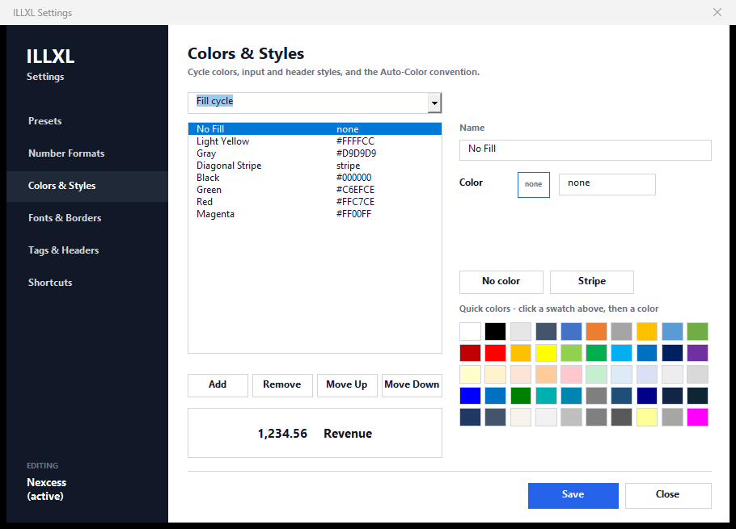

<p align="center"></p>

# ILLXL
### The Illest Excel Add-In for Finance Pros

**50+ keyboard shortcuts. Zero cost. All ILL.**

Tired of paying $125–200/year for WSP Boost, WST Macros, or Macabacus? ILLXL is a free, open-source Excel add-in built specifically for finance professionals — covering everything the paid tools do, plus features they don't.

---

## What's Inside

| Module | What It Does |
|---|---|
| **modCore** | Performance mode, undo engine, navigate to blanks/errors, absolute/relative refs |
| **modSettings** | Presets - loads every list, color and key from a shareable `.ini` file |
| **modFormatCycles** | Cycle number, date, currency, percent formats. Adjust decimals. Scale. Toggle sign. |
| **modFormulas** | CAGR, % change, equals-left, growth rate, quick SUM/AVERAGE |
| **modStyles** | Auto-color, font/fill/color cycles, input styles, header styles, indent, zero-check CF |
| **modBorders** | Cycle individual borders, apply outline + inside, sum bars |
| **modUnitTags** | Cycle FAST-standard unit tags ([mln $], [%], [x], [bps], etc.) |

### What's New in the Source (next release)

The `ILLXL.xlam` download is still the March 2026 build. The code in `src/` adds:


- **ILLXL ribbon tab** - every command one click away. Dropdowns list the actual steps of each cycle (formats shown as live samples, styles and colors as swatches), and every tooltip shows the shortcut from your active preset.
- **Model Tools** - find hardcoded numbers inside formulas and formulas that break their row's pattern, list every external link, wrap / unwrap IFERROR (`Ctrl+Alt+Shift+F`) and ROUND, build a hyperlinked sheet index, and **Ready to Send** (`Ctrl+Alt+Shift+Home`): every sheet back to its first cell under the freeze panes before you email a model.
- **Update notice** - a quiet once-a-day check for a newer release on GitHub (only the version is requested; switch off in settings.ini).
- **Settings window** (`Ctrl+Alt+Shift+S`) - edit presets, format cycles, colors, fonts, tags and shortcut keys without touching a file. Formats are checked as you type; shortcut conflicts are caught before they happen.



- **Presets** - every format cycle, color convention, input/header style and shortcut key now lives in a plain-text `.ini` file. Switch your whole setup in one step, share a preset with a colleague, or edit it in Notepad. Ships with **Bruce Home** (the original ILLXL style), **Banker** (standard IB / WSP conventions) and **Nexcess** (corporate FP&A). Up to 3 presets; `Ctrl+Alt+Shift+S` to switch.
- **Undo restores formatting** - Ctrl+Z now brings back fills, fonts, borders, number formats and conditional formatting, and always lands on the right sheet.
- **Safer macros** - scale / sign / x100 leave blank cells blank, Text Case never overwrites formulas, Auto-Color no longer treats table references as external links, and every shortcut is handed back to Excel when the add-in unloads.
- **Break External Links retired** - Data > Edit Links > Break Link does it safely.

---

## Why ILLXL?

- **Free. Forever.** No subscription, no trial, no upsell.
- **Custom undo engine** — every shortcut supports Ctrl+Z across up to 5,000 cells simultaneously (values, formulas, and number formats).
- **Performance mode** — disables calc, screen updates, events, and CF for blazing-fast bulk formatting. One keystroke on, one keystroke off.
- **FAST-standard unit tags** — cycle through [mln $], [thd $], [bn $], [%], [x], [pp], [bps] and more in two keystrokes. No more typing tags manually.
- **Zero-Check CF** — green if zero (balanced), red if not. Two keystrokes vs a full dialog workflow. Built for balance sheet checks.
- **Auto-Color** — instantly color-code an entire model: blue=hardcode, black=formula, green=sheet ref, red=external link.
- **Center Across Selection** — one keystroke. No more Merge & Center.

---

## Installation

1. Download `ILLXL.xlam` from this repo
2. Open Excel → **File → Options → Add-ins**
3. At the bottom, set **Manage: Excel Add-ins** → click **Go...**
4. Click **Browse**, navigate to `ILLXL.xlam`, click OK
5. Make sure the ILLXL checkbox is checked → **OK**

Shortcuts load automatically every time Excel opens.

---

## Keyboard Shortcuts

📄 **[Download the full shortcut reference PDF](ILLXL_Shortcut_Reference.pdf)**

### modCore — Utilities
| Shortcut | Action |
|---|---|
| Ctrl+Alt+Shift+M | Toggle Performance Mode |
| Ctrl+Alt+Shift+A | Make References Absolute ($A$1) |
| Ctrl+Alt+Shift+R | Make References Relative (A1) |
| Ctrl+Alt+Shift+N | Go To Next Blank in Selection |
| Ctrl+Alt+Shift+E | Go To Next Error in Selection |
| Ctrl+Alt+Shift+L | Break External Links (convert to values) |

### modFormatCycles — Number Formats
| Shortcut | Action |
|---|---|
| Ctrl+Shift+1 | Cycle Number Format (#,##0 → K → M) |
| Ctrl+Shift+3 | Cycle Date Format (m/d/yyyy → m/d/yy → mmm-yy → d-mmm-yy) |
| Ctrl+Shift+4 | Cycle Currency Format ($#,##0 → $K → $M) |
| Ctrl+Shift+5 | Cycle Percent Format (0.0% → 0% → +/- → ...) |
| Ctrl+Shift+8 | Cycle Other Formats (A=Actual / B=Budget / F=Forecast / Q / P / E / x) |
| Ctrl+Shift+> | Increase Decimal Places |
| Ctrl+Shift+< | Decrease Decimal Places |
| Alt+Shift+< | Scale Up ÷1,000 |
| Alt+Shift+> | Scale Down ×1,000 |
| Ctrl+Alt+Shift+\ | Toggle Sign (positive ↔ negative) |
| Ctrl+Alt+2 | Divide by 100 (5 → 0.05) |
| Ctrl+Alt+Shift+2 | Multiply by 100 (0.05 → 5) |

### modFormulas — Formula Tools
| Shortcut | Action |
|---|---|
| Ctrl+Alt+Shift+C | Insert CAGR — n = end year minus start year (2023→2026 = 3) |
| Ctrl+Alt+Shift+W | Insert % Change =(Current−Prior)/ABS(Prior) |
| Ctrl+Alt+D | Equals Left — link each cell to the cell on its left |
| Ctrl+Alt+Shift+G | Apply Growth Rate =LEFT×(1+rate) |
| Ctrl+Alt+= | Quick SUM |
| Ctrl+Alt+Shift+= | Quick Average |

### modStyles — Colors, Fonts & Layout
| Shortcut | Action |
|---|---|
| Ctrl+Alt+A | Auto-Color entire selection |
| Ctrl+' | Cycle Font (Aptos Narrow → Poppins → Times New Roman) |
| Ctrl+Shift+K | Cycle Fill Color |
| Ctrl+Alt+Shift+I | Cycle Text Case (Title → lower → UPPER) |
| Ctrl+Shift+C | Cycle Font Color |
| Ctrl+Shift+F | Increase Font Size |
| Ctrl+Shift+G | Decrease Font Size |
| Ctrl+Alt+> | Indent In |
| Ctrl+Alt+< | Indent Out |
| Ctrl+Alt+E | Center Across Selection (no more Merge & Center) |
| Ctrl+Shift+N | Insert Static Timestamp |
| Ctrl+Alt+Shift+U | Cycle Input Style (Yellow → Lt Yellow → Gray → Peach → Pale Blue) |
| Ctrl+Alt+Shift+H | Cycle Header Style |
| Ctrl+Alt+Shift+Y | Insert Headers from Prompt |
| Ctrl+Alt+Shift+D | Insert Variance Headers (AvF % / AvB % / Var AvB) |
| Ctrl+Alt+Shift+Z | Apply Zero-Check CF |
| Ctrl+Alt+Shift+X | Clear Zero-Check CF |

### modBorders — Border Cycles
| Shortcut | Action |
|---|---|
| Ctrl+Alt+Shift+↑ | Cycle Top Border (Thin → None → Medium → Hairline) |
| Ctrl+Alt+Shift+↓ | Cycle Bottom Border |
| Ctrl+Alt+Shift+← | Cycle Left Border |
| Ctrl+Alt+Shift+→ | Cycle Right Border |
| Ctrl+Alt+Shift+B | Outline (Medium) + Inside (Thin) |
| Ctrl+Alt+− | Apply Sum Bar |
| Ctrl+Alt+_ | Apply Double Sum Bar |

### modUnitTags — Unit Tags
| Shortcut | Action |
|---|---|
| Ctrl+Alt+Shift+T | Cycle Value Tag: [#] [%] [mln $] [thd $] [bn $] [x] [pp] [bps] |
| Ctrl+Alt+Shift+O | Cycle Duration Tag: [d] [m] [q] [y] |
| Ctrl+Alt+Shift+P | Cycle Rate Tag: [%/y] [$/unit] [$/FTE] [$/yr] |
| Ctrl+Alt+Shift+Backspace | Remove Last Unit Tag |

---

## Input Style Reference

| Step | Style | Fill | Font | Use Case |
|---|---|---|---|---|
| 1 | Yellow | #FFF2CC | Blue | Primary hardcoded assumptions |
| 2 | Light Yellow | #FFFFCC | Blue | Secondary / supporting assumptions |
| 3 | Gray | #D9D9D9 | Blue | Linked / locked cells |
| 4 | Peach | #FFC799 | Teal | Special flagged inputs |
| 5 | Pale Blue | #DDEBF7 | Dark Blue | Override cells |

---

## Build From Source

Requires Windows, Excel, Python 3, and Excel's *Trust access to the VBA project object model* option (File > Options > Trust Center > Trust Center Settings > Macro Settings).

```powershell
pwsh -File build.ps1 -Edition Public     # -> build\ILLXL.xlam (Bruce Home preset by default)
pwsh -File install.ps1 -Edition Public   # close Excel first; installs to %APPDATA%\Microsoft\AddIns
pwsh -File tests\run-tests.ps1            # regression tests (hidden Excel)
pwsh -File tests\run-matrix.ps1           # every command x 10 kinds of selection + behaviour checks
pwsh -File tests\keys-live.ps1            # presses every shortcut for real (visible Excel, ~1 min)
python -I tools\make-pdf.py "Bruce Home" docs\ILLXL_Shortcut_Reference.pdf
```

The shortcut PDF is generated from the same command list and preset files the add-in uses, so it can't drift: [docs/ILLXL_Shortcut_Reference.pdf](docs/ILLXL_Shortcut_Reference.pdf).

| Folder | Contents |
|---|---|
| `src/` | VBA modules (UTF-8; the build converts them for the VBA editor) |
| `presets/` | Shipped presets - copied to `%APPDATA%\ILLXL\presets\` on first run, edit those copies |
| `tests/` | Regression tests |

---

## Compared to Paid Alternatives

| Feature | ILLXL | WSP Boost | Macabacus |
|---|---|---|---|
| Price | **Free** | ~$150/yr | ~$200/yr |
| Number format cycles | ✅ | ✅ | ✅ |
| Border cycles | ✅ | ✅ | ✅ |
| Input styles | ✅ | ✅ | ✅ |
| Custom undo engine | ✅ | ❌ | ❌ |
| Performance mode | ✅ | ❌ | ❌ |
| FAST unit tags | ✅ | ❌ | ❌ |
| Zero-check CF | ✅ | ❌ | ❌ |
| Action logging | ✅ | ❌ | ❌ |
| Open source | ✅ | ❌ | ❌ |

---

## Built By

**Bruce Zachary Illes**
[LinkedIn](https://linkedin.com/in/brucezacharyilles) · [GitHub](https://github.com/bzilles015)

---

*ILLXL — because mediocre tools cost too much.*
