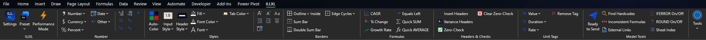

<p align="center"></p>

# ILLXL
### The Illest Excel Add-In for Finance Pros

**50+ keyboard shortcuts. Zero cost. All ILL.**

Tired of paying $125–200/year for WSP Boost, WST Macros, or Macabacus? ILLXL is a free, open-source Excel add-in built specifically for finance professionals — covering everything the paid tools do, plus features they don't.

---

## What's Inside

| Module | What It Does |
|---|---|
| **modCore** | Performance mode, undo engine, navigate to blanks/errors, absolute/relative refs |
| **modSettings** | Presets - loads every list, color and key from a shareable `.ini` file |
| **modFormatCycles** | Cycle number, date, currency, percent formats. Adjust decimals. Scale. Toggle sign. |
| **modFormulas** | CAGR, % change, equals-left, growth rate, quick SUM/AVERAGE |
| **modStyles** | Auto-color, font/fill/color cycles, input styles, header styles, indent, zero-check CF |
| **modBorders** | Cycle individual borders, apply outline + inside, sum bars |
| **modUnitTags** | Cycle FAST-standard unit tags ([mln $], [%], [x], [bps], etc.) |

### What's New in v2.0

A ground-up rebuild of the March 2026 release:



- **ILLXL ribbon tab** - every command one click away. Dropdowns list the actual steps of each cycle (formats shown as live samples, styles and colors as swatches), and every tooltip shows the shortcut from your active preset.
- **Model Tools** - find hardcoded numbers inside formulas and formulas that break their row's pattern, list every external link, wrap / unwrap IFERROR (`Ctrl+Alt+Shift+F`) and ROUND, build a hyperlinked sheet index, and **Ready to Send** (`Ctrl+Alt+Shift+Home`): every sheet back to its first cell under the freeze panes before you email a model.
- **Update notice** - a quiet once-a-day check for a newer release on GitHub (only the version is requested; switch off in settings.ini).
- **Settings window** (`Ctrl+Alt+Shift+S`) - edit presets, format cycles, colors, fonts, tags and shortcut keys without touching a file. Formats are checked as you type; shortcut conflicts are caught before they happen.


- **Presets** - every format cycle, color convention, input/header style and shortcut key now lives in a plain-text `.ini` file. Switch your whole setup in one step, share a preset with a colleague, or edit it in Notepad. Ships with **Bruce Home** (the original ILLXL style), **Banker** (standard IB / WSP conventions) and **Nexcess** (corporate FP&A). Up to 3 presets; `Ctrl+Alt+Shift+S` to switch.
- **Undo restores formatting** - Ctrl+Z now brings back fills, fonts, borders, number formats and conditional formatting, and always lands on the right sheet.
- **Safer macros** - scale / sign / x100 leave blank cells blank, Text Case never overwrites formulas, Auto-Color no longer treats table references as external links, and every shortcut is handed back to Excel when the add-in unloads.
- **Break External Links retired** - Data > Edit Links > Break Link does it safely.

---

## Why ILLXL?

- **Free. Forever.** No subscription, no trial, no upsell.
- **Custom undo engine** — every shortcut supports Ctrl+Z across up to 5,000 cells simultaneously (values, formulas, and number formats).
- **Performance mode** — disables calc, screen updates, events, and CF for blazing-fast bulk formatting. One keystroke on, one keystroke off.
- **FAST-standard unit tags** — cycle through [mln $], [thd $], [bn $], [%], [x], [pp], [bps] and more in two keystrokes. No more typing tags manually.
- **Zero-Check CF** — green if zero (balanced), red if not. Two keystrokes vs a full dialog workflow. Built for balance sheet checks.
- **Auto-Color** — instantly color-code an entire model: blue=hardcode, black=formula, green=sheet ref, red=external link.
- **Center Across Selection** — one keystroke. No more Merge & Center.

---

## Installation

1. Download `ILLXL.xlam` from the [latest release](https://github.com/bzilles015/ILLXL---Custom-Excel-Add-in/releases/latest)
2. Open Excel → **File → Options → Add-ins**
3. At the bottom, set **Manage: Excel Add-ins** → click **Go...**
4. Click **Browse**, navigate to `ILLXL.xlam`, click OK
5. Make sure the ILLXL checkbox is checked → **OK**

Shortcuts load automatically every time Excel opens.

---

## Keyboard Shortcuts

Default keys (every key can be changed in **Settings > Shortcuts**). Everything is also on the **ILLXL** ribbon tab.

📄 **[Download the full shortcut reference PDF](ILLXL_Shortcut_Reference.pdf)**

### Core
*Settings, performance mode, navigation and formula references.*

| Shortcut | Command | What it does |
|---|---|---|
| `Ctrl+Alt+Shift+S` | **ILLXL Settings / Presets** | Open the Settings window: presets, cycles, colors, fonts, tags and shortcut keys. |
| `Ctrl+Alt+Shift+M` | **Toggle Performance Mode** | Manual calc, events and conditional formatting off for heavy formatting. Press again to switch back. Undo is off while it is on. |
| `Ctrl+Alt+Shift+A` | **Make References Absolute** | Turn A1 into $A$1 in every formula in the selection. |
| `Ctrl+Alt+Shift+R` | **Make References Relative** | Turn $A$1 into A1 in every formula in the selection. |
| `Ctrl+Alt+Shift+N` | **Go To Next Blank Cell** | Jump to the next empty cell in the selection. |
| `Ctrl+Alt+Shift+E` | **Go To Next Error Cell** | Jump to the next #REF!, #N/A, #DIV/0! ... in the selection. |
| `Ctrl+Alt+Shift+K` | **Toggle Error Checking** | Hide or show Excel's green error triangles - for presentation-ready sheets. |
| - | **Remove Unused Cell Styles** | Delete custom cell styles that no cell uses (asks first). |
| - | **Check for Updates** | See whether a newer ILLXL is out on GitHub. |

### Number Formats
*Cycle formats - press again for the next step. Restarts when the selection changes.*

| Shortcut | Command | What it does |
|---|---|---|
| `Ctrl+Shift+1` | **Cycle Number Format** | Step through the number formats in your preset (e.g. 1,234 -> 1K -> 1.2M). |
| `Ctrl+Shift+3` | **Cycle Date Format** | Step through the date formats in your preset. |
| `Ctrl+Shift+4` | **Cycle Currency Format** | Step through the currency formats in your preset. |
| `Ctrl+Shift+5` | **Cycle Percent Format** | Step through the percent formats in your preset. |
| `Ctrl+Shift+8` | **Cycle Other Formats (A/B/F/Q/x)** | Year tags (2026A / B / F / E), quarters and multiples (12.5x). |
| `Ctrl+Shift+.` | **Increase Decimals** | One more decimal place - works on custom formats too. |
| `Ctrl+Shift+,` | **Decrease Decimals** | One less decimal place - works on custom formats too. |
| `Alt+Shift+<` | **Divide by 1,000** | Divide numbers by 1,000; formulas become =(...)/1000. |
| `Alt+Shift+>` | **Multiply by 1,000** | Multiply numbers by 1,000; formulas become =(...)*1000. |
| `Ctrl+Alt+Shift+\` | **Toggle Sign** | Flip positive <-> negative; formulas are wrapped as =-(...) and unwrapped again. |
| `Ctrl+Alt+2` | **Divide by 100** | Divide by 100 (5 -> 0.05) for entering percentages. |
| `Ctrl+Alt+Shift+2` | **Multiply by 100** | Multiply by 100 (0.05 -> 5). |

### Formulas
*Financial formulas in one keystroke. Picked cells can be on any sheet.*

| Shortcut | Command | What it does |
|---|---|---|
| `Ctrl+Alt+Shift+C` | **Insert CAGR** | =(End/Begin)^(1/n)-1. Pick the two cells; n = end year minus start year. |
| `Ctrl+Alt+Shift+V` | **Insert % Change** | =(Current-Prior)/ABS(Prior), using the two cells to the left. |
| `Ctrl+Alt+L` | **Equals Left** | Link each selected cell to the cell on its left. |
| `Ctrl+Alt+Shift+G` | **Apply Growth Rate** | =Left*(1+rate) across the selection. Type a rate or click the cell that holds it. |
| `Ctrl+Alt+=` | **Quick SUM** | Pick a range (any sheet) and SUM it into the selected cell. |
| `Ctrl+Alt+Shift+=` | **Quick AVERAGE** | Pick a range (any sheet) and AVERAGE it into the selected cell. |

### Styles & Layout
*Colors, fonts, input and header styles, indent, headers and checks.*

| Shortcut | Command | What it does |
|---|---|---|
| `Ctrl+Alt+A` | **Auto-Color (inputs / formulas / links)** | Color cells by what they hold: hardcodes, formulas, same-sheet, other-sheet and other-file links (colors from your preset). |
| `Ctrl+'` | **Cycle Font** | Step through the fonts in your preset. |
| `Ctrl+Shift+K` | **Cycle Fill** | Step through the fill colors in your preset. |
| `Ctrl+Alt+Shift+I` | **Cycle Text Case** | Title Case -> lower case -> UPPER CASE (typed text only, never formulas). |
| `Ctrl+Shift+C` | **Cycle Font Color** | Step through the font colors in your preset. |
| `Ctrl+Shift+F` | **Increase Font Size** | Font one point bigger (mixed sizes each step from their own size). |
| `Ctrl+Shift+G` | **Decrease Font Size** | Font one point smaller. |
| `Ctrl+Alt+.` | **Indent In** | Indent one level (left-aligns so the indent shows). |
| `Ctrl+Alt+,` | **Indent Out** | Remove one indent level. |
| `Ctrl+Alt+E` | **Center Across Selection** | Center across the selected cells without merging them. |
| `Ctrl+Shift+N` | **Insert Timestamp** | Stamp the current date and time as a value; press again for the next format. |
| `Ctrl+Alt+Shift+U` | **Cycle Input Style** | Step through the input styles in your preset (fill, font color, dotted border). |
| `Ctrl+Alt+Shift+H` | **Cycle Header Style** | Step through the header styles in your preset (fill, font color, bold). |
| `Ctrl+Alt+Shift+Y` | **Insert Headers** | Type headers like 2024A,2025B,2026E and they fill across, styled. |
| `Ctrl+Alt+Shift+D` | **Insert Variance Headers** | Insert the variance header labels from your preset, styled. |
| `Ctrl+Alt+Shift+Z` | **Apply Zero-Check** | Green when the cell is 0, red when it isn't - for balance checks. |
| `Ctrl+Alt+Shift+X` | **Clear Zero-Check** | Remove ILLXL's zero-check formatting from the selection. |
| `Ctrl+Alt+Shift+W` | **Cycle Tab Color** | Step the sheet tab through the tab colors in your preset. |

### Borders
*Edge cycles restart at step 1 when the selection changes.*

| Shortcut | Command | What it does |
|---|---|---|
| `Ctrl+Alt+Shift+Up` | **Cycle Top Border** | Step the top edge through your border cycle (e.g. thin -> none -> medium -> hairline). |
| `Ctrl+Alt+Shift+Down` | **Cycle Bottom Border** | Step the bottom edge through your border cycle. |
| `Ctrl+Alt+Shift+Left` | **Cycle Left Border** | Step the left edge through your border cycle. |
| `Ctrl+Alt+Shift+Right` | **Cycle Right Border** | Step the right edge through your border cycle. |
| `Ctrl+Alt+Shift+B` | **Outline + Inside Borders** | Medium outline with thin inside lines. |
| `Ctrl+Alt+-` | **Sum Bar** | Thin line above the totals row. |
| `Ctrl+Alt+_` | **Double Sum Bar** | Thin line above and double line below - for grand totals. |

### Unit Tags
*FAST-standard tags. Typed text only - formulas are never touched.*

| Shortcut | Command | What it does |
|---|---|---|
| `Ctrl+Alt+Shift+T` | **Cycle Value Tag** | Add or cycle a value tag: [#] [%] [$] [mln $] ... (FAST standard). |
| `Ctrl+Alt+Shift+O` | **Cycle Duration Tag** | Add or cycle a duration tag: [d] [m] [q] [y]. |
| `Ctrl+Alt+Shift+P` | **Cycle Rate Tag** | Add or cycle a rate tag: [%/y] [$/unit] [$/FTE] [$/yr]. |
| `Ctrl+Alt+Shift+Backspace` | **Remove Unit Tag** | Remove the last [...] tag from each selected cell. |

### Model Tools
*Audit a model, wrap formulas, build an index, and get a model ready to send.*

| Shortcut | Command | What it does |
|---|---|---|
| - | **Find Hardcodes in Formulas** | Select every formula with a typed-in number (=A1*1.05). Works on the selection, or the whole sheet when one cell is selected. |
| - | **Find Inconsistent Formulas** | Select formulas that break the pattern of the formulas beside them in their row. |
| - | **External Link Report** | List every cell and name that links to another file, each with a link to jump to it. |
| `Ctrl+Alt+Shift+Home` | **Ready to Send** | Every sheet back to its first cell below the freeze panes (or A1), first sheet shown - before you send a model. |
| `Ctrl+Alt+Shift+F` | **Wrap / Unwrap IFERROR** | Wrap the selected formulas in IFERROR(...,0); press again to take it off. The fallback value is in your preset. |
| - | **Wrap / Unwrap ROUND** | Wrap the selected formulas in ROUND(...,0); press again to take it off. Digits are in your preset. |
| - | **Sheet Index** | Add (or refresh) a hyperlinked table of contents at the front of the workbook. |

---

## Build From Source

Requires Windows, Excel, Python 3, and Excel's *Trust access to the VBA project object model* option (File > Options > Trust Center > Trust Center Settings > Macro Settings).

```powershell
pwsh -File build.ps1 -Edition Public     # -> build\ILLXL.xlam (Bruce Home preset by default)
pwsh -File install.ps1 -Edition Public   # close Excel first; installs to %APPDATA%\Microsoft\AddIns
pwsh -File tests\run-tests.ps1            # regression tests (hidden Excel)
pwsh -File tests\run-matrix.ps1           # every command x 10 kinds of selection + behaviour checks
pwsh -File tests\keys-live.ps1            # presses every shortcut for real (visible Excel, ~1 min)
python -I tools\make-pdf.py "Bruce Home" docs\ILLXL_Shortcut_Reference.pdf
```

The shortcut PDF is generated from the same command list and preset files the add-in uses, so it can't drift: [docs/ILLXL_Shortcut_Reference.pdf](docs/ILLXL_Shortcut_Reference.pdf).

| Folder | Contents |
|---|---|
| `src/` | VBA modules (UTF-8; the build converts them for the VBA editor) |
| `presets/` | Shipped presets - copied to `%APPDATA%\ILLXL\presets\` on first run, edit those copies |
| `tests/` | Regression tests |

---

## Compared to Paid Alternatives

| Feature | ILLXL | WSP Boost | Macabacus |
|---|---|---|---|
| Price | **Free** | ~$150/yr | ~$200/yr |
| Number format cycles | ✅ | ✅ | ✅ |
| Border cycles | ✅ | ✅ | ✅ |
| Input styles | ✅ | ✅ | ✅ |
| Custom undo engine | ✅ | ❌ | ❌ |
| Performance mode | ✅ | ❌ | ❌ |
| FAST unit tags | ✅ | ❌ | ❌ |
| Zero-check CF | ✅ | ❌ | ❌ |
| Action logging | ✅ | ❌ | ❌ |
| Open source | ✅ | ❌ | ❌ |

---

## Built By

**Bruce Zachary Illes**
[LinkedIn](https://linkedin.com/in/brucezacharyilles) · [GitHub](https://github.com/bzilles015)

---

*ILLXL — because mediocre tools cost too much.*
